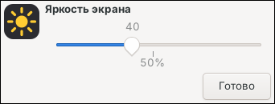

# IceWM for antiX

[Русский](README.md) | **English**

Fixes and tools for macOS-style IceWM on antiX Linux.

- [fix-icewm-buttons.sh](#fix-icewm-buttonssh--black-bar-under-the-window-buttons): removes the black bar under the window buttons
- [brightness/](brightness/README.en.md): a brightness slider button and everything about screen brightness
- [BROWSER.en.md](BROWSER.en.md): which browser to install so it doesn't eat all your RAM

## fix-icewm-buttons.sh — black bar under the window buttons

### Symptom

The "traffic light" buttons on the left of the title bar (close / minimize / maximize)
are cut in half, with a black rectangle underneath them. It shows up on every window
and moves with the window. Turning off picom (`pkill picom`) does not remove it.

### Cause

In IceWM, every title bar button image (`closeA.xpm`, `maximizeA.xpm`,
`minimizeA.xpm`, etc.) must contain **two states stacked vertically**:
normal on top, pressed below. So the image must be **twice as tall** as the button
(see [IceWM Theme Creation Howto](https://ice-wm.org/themes/)).

If a theme ships single-state images (for example, 20×28 with `TitleBarHeight=28`),
IceWM shows only their top half, and the rest of the title bar stays black.

### What the script does

1. Finds the current IceWM theme from `~/.icewm/theme`, or uses the theme folder passed as an argument.
2. Backs up the button images to `~/knopki-backup/<date>/`.
3. Doubles the height of **single-state** button images only. Running it again is
   safe: images that are already fixed are left alone.
4. Also fixes the theme copy in the `~/Загрузки/antix-macos-look` (or
   `~/Downloads/antix-macos-look`) kit, if present, so re-running its `install.sh`
   does not bring the problem back.
5. Restarts IceWM and picom.

If ImageMagick is not installed, the script installs it (you will be asked for your password).

The script's on-screen messages are in Russian.

### Install and run

```bash
mkdir -p ~/scripts
curl -L -o ~/scripts/fix-icewm-buttons.sh \
  https://raw.githubusercontent.com/gasek46-eng/icewm-for-antix/main/fix-icewm-buttons.sh
bash ~/scripts/fix-icewm-buttons.sh
```

Run it **without `sudo`**: the theme lives in your home folder.

For a different theme, pass its folder:

```bash
bash ~/scripts/fix-icewm-buttons.sh ~/.icewm/themes/THEME-NAME
```

### Undo

The script prints the exact undo command when it finishes. In general:

```bash
cp ~/knopki-backup/<date>/*.xpm ~/.icewm/themes/<theme>/
icewm --restart &
```

### Tested on

- antiX 26.1 (x64), IceWM, `macOS-antiX` theme, buttons 20×28 → 20×56.

## brightness/ — brightness button



A sun icon on the IceWM top panel and in the Plank dock. Click it to get a slider:
brightness changes live as you drag it. The installer also sets up
**Fn+F9 / Fn+F10** (10% darker / brighter) and adds a "Brightness" menu entry.

The slider stops at 5%, so the screen can't be turned fully dark by accident.

### Install

```bash
cd ~/Downloads
git clone https://github.com/gasek46-eng/icewm-for-antix
bash icewm-for-antix/brightness/install-brightness-button.sh
```

Without git: download the repository archive (Code → Download ZIP), unpack it and run
`install-brightness-button.sh` from the `brightness` folder.

Run it **without `sudo`**. The script will:
- install `yad` and `brightnessctl` if they are missing (asks for your password);
- add your user to the `video` group. After the first install, **log out and back in**,
  otherwise brightness won't change.

Running it again is safe: nothing gets duplicated. The script's messages are in Russian.

### Remove

```bash
bash icewm-for-antix/brightness/install-brightness-button.sh --remove
```
