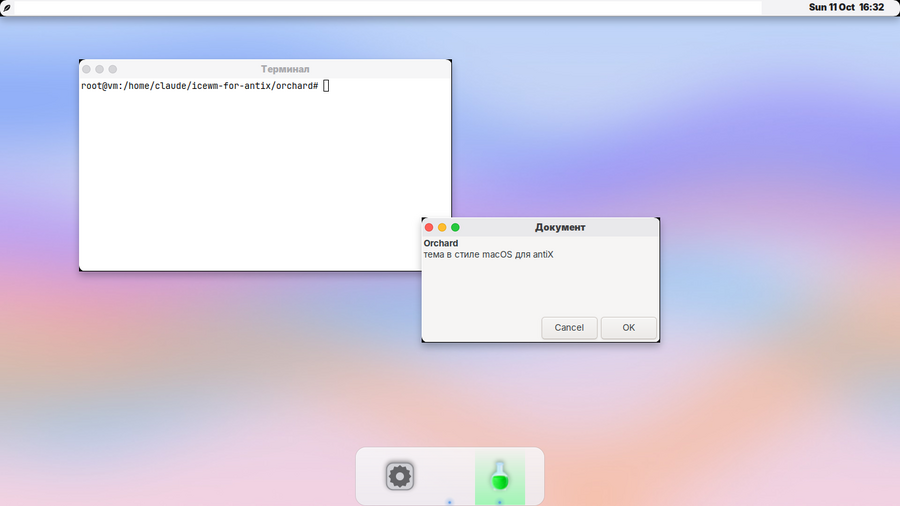
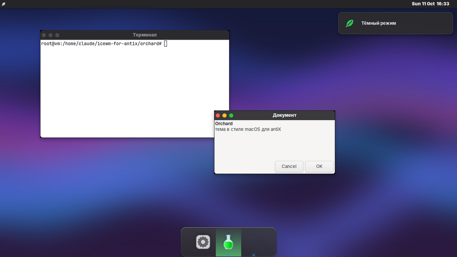

# Orchard — macOS-style antiX

[Русский](README.md) | **English**




A complete new theme for antiX with IceWM: windows, top bar, dock, wallpapers, search,
notifications, light and dark mode. No Apple logos; all artwork is original.

## What's inside

- **Windows**: traffic-light buttons on the left (×, −, ⤢ on hover), centered title, shadows, rounded corners.
- **Top bar** like a menu bar: leaf menu on the left, tray and clock on the right.
- **Plank dock** at the bottom with zoom; running apps show in the dock.
- **App search** (Super+Space) and **notifications** at the top right.
- **Light and dark mode**, each with its own wallpaper; toggle with Super+Shift+D.
- **Orchard Settings** (Super+,): mode, wallpaper, dock size and autohide, effects, brightness.
- **Fonts**: Inter and JetBrains Mono with crisp antialiasing.
- **WhiteSur** app themes, icons and cursors (downloaded during install).

## Install

```bash
cd ~/Downloads
git clone https://github.com/gasek46-eng/icewm-for-antix
bash icewm-for-antix/orchard/install.sh
```

Run without `sudo`; it asks for your password. Needs internet. Offline:
`bash install.sh --no-whitesur` (default app themes). **Log out and back in** afterwards.

The installer makes a backup, disables Conky and other picom/plank autostarts
(e.g. from `antix-macos-look`) so nothing runs twice. Its messages are in Russian.

## Shortcuts

| Keys | Action |
|---|---|
| Super+Space | app search |
| Super+, | Orchard Settings |
| Super+Shift+D | light ↔ dark mode |
| Super+Q / Super+M | close / minimize window |
| Super+E / Super+T | files / terminal |
| Super+Shift+3 / 4, Print | screenshot / area |
| Super+L | lock screen |
| Alt+Tab | switch windows |

From a terminal: `orchard-ctl mode dark`, `orchard-ctl wallpaper ~/picture.jpg`,
`orchard-ctl dock size 56`, `orchard-ctl effects off`.

## Remove

```bash
bash ~/.local/share/orchard/install.sh --remove
```

Restores every changed file from the backup.

## Tested

Install, light/dark mode, dock, notifications and removal were tested on a virtual display
(IceWM 3.4, picom, Plank). Not yet tested on real antiX 26 — please report issues.
Regenerate artwork with `python3 tools/build-assets.py`.
